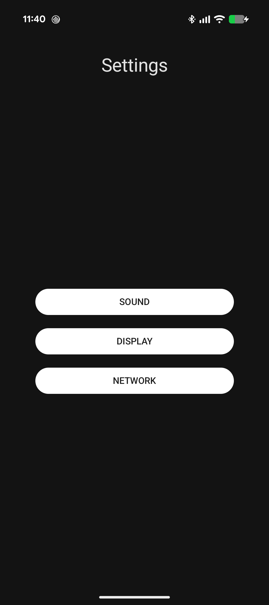
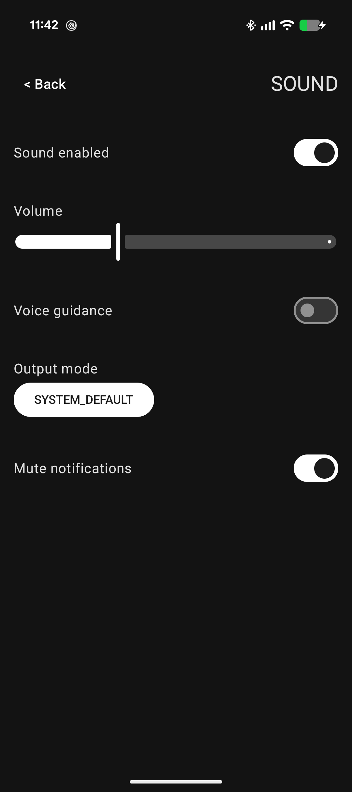

# Reflection vs. KSP – Android teljesítmény-összehasonlítás

Android-projekt, amely a **Kotlin Reflection** és a **Kotlin Symbol Processing (KSP)** megközelítéseit hasonlítja össze beállításmodellek létrehozása és felhasználói felületi elemekké alakítása során.

A projekt mindkét megoldást azonos interfészek mögött valósítja meg, AndroidX Benchmark segítségével méri a futásidejű teljesítményüket, és vizsgálja az R8-optimalizáció hatásait.

**Dokumentáció:** [English](README.md) | Magyar

## Képernyőképek

Az alkalmazás Jetpack Compose és Material 3 használatával készült beállításkezelő felületet biztosít.

| Kategóriák | Beállítások részletes nézete |
|---|---|
|  |  |

## A projekt céljai

- A futásidejű Reflection és a fordításidejű kódgenerálás összehasonlítása.
- A modell-létrehozás, a UI-leképezés és a teljes feldolgozási folyamat mérése.
- A végrehajtási idő és a memóriaallokációk vizsgálata.
- Az R8-optimalizáció lehetőségeinek és korlátainak feltárása.
- Gyakorlati Android-architektúra bemutatása Jetpack Compose, Room, Koin és Kotlin Coroutines használatával.

## Architektúra

A projekt négy Gradle-modulból áll:

| Modul | Feladat |
|---|---|
| `app` | Android-alkalmazás, beállításkezelő UI, adatelérés és Reflection/KSP implementációk |
| `settings-annotations` | A kódgeneráláshoz használt annotációk |
| `settings-processor` | Saját KSP annotációfeldolgozó |
| `benchmark` | AndroidX Benchmark teljesítménytesztek |

Mindkét implementáció ugyanazokat az interfészeket használja:

- `ISettingsModelFactory` – beállításmodell létrehozása a tárolt adatokból.
- `ISettingsMapper` – a modell átalakítása UI-elemekké.

Az alkalmazás a Koin dependency injection segítségével választja ki az induláskor használt implementációt.

### Feldolgozási folyamat

```text
SettingsRepository
       |
       v
ISettingsModelFactory
       |
       v
ISettingsMapper
       |
       v
SettingsViewModel
       |
       v
Jetpack Compose UI
```

A felhasználói felület kapcsolókat, csúszkákat és választóelemeket támogat. A változások `StateFlow`-alapú UI-állapotban jelennek meg, a mentés pedig késleltetett, összevont műveletekkel történik.

## Reflection és KSP

**Reflection implementáció**

A Kotlin Reflection segítségével futásidőben vizsgálja a modellek metaadatait, és ezek alapján állítja elő a felhasználói felület reprezentációját.

**KSP implementáció**

Egy saját KSP processzor fordítási időben generálja a szükséges kódot, így csökkenti a futásidejű metaadat-feldolgozás szükségességét.

A két megoldás dependency injection segítségével cserélhető, a ViewModel és a UI módosítása nélkül.

## Konfiguráció

Az alkalmazás alapértelmezett konfigurációja:

```kotlin
MappingMode.REFLECTION
DataSourceMode.LOCAL
```

A generált implementáció használatához a `SettingsApplication.kt` fájlban a mapping módot kell módosítani:

```kotlin
MappingMode.KSP
```

Az alkalmazás `MOCK` és `LOCAL` adatforrást is támogat.

## Benchmarkeredmények

A mérések **Google Pixel 9a készüléken, Android 17 (API 37)** rendszeren, AndroidX Benchmark 1.4.1 használatával készültek.

Az alábbi táblázat konfigurációnként öt benchmarkfuttatás medián végrehajtási idejének összesített mediánját mutatja.

| Művelet | Reflection (R8 OFF) | KSP (R8 OFF) | Reflection (R8 ON) | KSP (R8 ON) |
|---|---:|---:|---:|---:|
| Modell-létrehozás | 6 839 ns | 94 ns | 6 710 ns | 95 ns |
| UI-leképezés | 11 659 ns | 162 ns | 11 468 ns | 171 ns |
| Teljes feldolgozás | 20 223 ns | 266 ns | 19 462 ns | 235 ns |

A teljes feldolgozási folyamat esetében a KSP-megoldás megközelítőleg:

- **76-szoros gyorsulást** ért el R8 nélkül.
- **83-szoros gyorsulást** ért el R8 mellett.
- **95%-kal kevesebb allokációt** eredményezett a Reflection-megoldáshoz képest.

Az eredmények a projekt konkrét implementációjára és benchmarkterhelésére vonatkoznak, nem általánosíthatók a Reflection és KSP minden lehetséges felhasználására.

### R8-optimalizációs tapasztalatok

Az R8 optimalizálta és részben beágyazta a generált implementáció kódját, míg a Reflection-megoldás továbbra is futásidejű reflexiót használt.

Az R8 OFF és R8 ON mérések eltérő Android buildverziókon készültek, ezért a köztük tapasztalt eltérések nem tulajdoníthatók kizárólag az R8-nak.

A projekt azt is vizsgálja, hogy a Kotlin runtime megtartási szabályai (*keep rules*) hogyan korlátozhatják az optimalizációt.

**Részletes mérési eredmények, módszertan, korlátok és R8-megfigyelések:**

- [Benchmarkeredmények (magyar)](benchmark-results/README-HU.md)
- [Benchmark results (English)](benchmark-results/README.md)

## Felhasznált technológiák

- Kotlin
- Kotlin Symbol Processing (KSP 2.3.10)
- Jetpack Compose és Material 3
- Room
- Koin
- Kotlin Coroutines és StateFlow
- AndroidX Benchmark 1.4.1
- Android Gradle Plugin 9.3.2
- Android SDK 37 (minimum SDK 24)

## Fordítás és futtatás

Nyisd meg a projektet Android Studióban, megfelelő Android SDK- és Gradle-környezettel.

A debug alkalmazás lefordítása:

```bash
./gradlew :app:assembleDebug
```

Windows alatt:

```powershell
.\gradlew.bat :app:assembleDebug
```

A beállításkezelő felület kipróbálásához futtasd az `app` modult Android-eszközön vagy emulátoron.

A projekt a teljesítménymérésekhez külön `benchmark` és `benchmarkR8` buildtípusokat tartalmaz.

## Tesztelés

A projekt unit teszteket tartalmaz a Reflection- és KSP-implementációk működésének és konzisztenciájának ellenőrzésére, valamint Gradle-integrációs teszteket a saját KSP processzorhoz.

A debug unit tesztek és a processzor integrációs tesztjeinek futtatása Windows alatt:

```powershell
.\gradlew.bat testDebugUnitTest :settings-processor:test
```

macOS vagy Linux alatt:

```bash
./gradlew testDebugUnitTest :settings-processor:test
```

Ezek a tesztek Android-emulátor vagy fizikai eszköz nélkül is futtathatók.

## Főbb tanulságok

A projekt bemutatja, hogy a fordításidejű kódgenerálás hogyan csökkentheti jelentősen a futásidejű többletköltséget egy metaadatvezérelt beállításkezelő rendszerben.

Arra is rávilágít, miért fontos a teljesítménymérések módszertana, a memóriaallokációk vizsgálata, a fordítói optimalizáció és a reprodukálhatóság az eredmények értékelésekor.

A cél nem annak állítása, hogy a KSP minden esetben gyorsabb, hanem annak bemutatása, **milyen helyzetekben és miért teljesíthet jobban a generált kód a futásidejű Reflection-megoldásnál egy konkrét Android-implementációban**.
