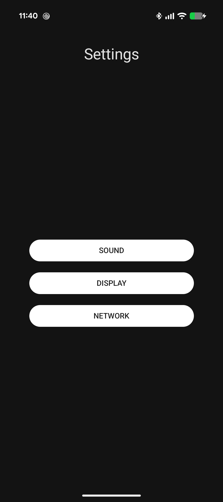

# Reflection vs. KSP — Android Performance Benchmark
**Documentation:** English | [Magyar](README-HU.md)

An Android project comparing **Kotlin Reflection** and **Kotlin Symbol Processing (KSP)** for creating settings models and mapping them into UI components.

The project implements both approaches behind the same interfaces, measures their runtime performance using AndroidX Benchmark, and explores the effects of R8 optimization.

## Screenshots

The application provides a settings interface built with Jetpack Compose and Material 3.

| Categories | Settings Detail |
|---|---|
|  |  |

## Project Goals

- Compare runtime reflection with compile-time generated code.
- Measure model creation, UI mapping, and complete processing pipelines.
- Evaluate execution time and memory allocations.
- Investigate R8 optimization and its limitations.
- Demonstrate a practical Android architecture using Jetpack Compose, Room, Koin, and Kotlin Coroutines.

## Architecture

The project consists of four Gradle modules:

| Module | Responsibility |
|---|---|
| `app` | Android application, settings UI, data access, and Reflection/KSP implementations |
| `settings-annotations` | Annotations used by the code-generation system |
| `settings-processor` | Custom KSP annotation processor |
| `benchmark` | AndroidX Benchmark tests |

Both implementations use the same contracts:

- `ISettingsModelFactory` — creates a settings model from stored data.
- `ISettingsMapper` — converts the model into UI items.

The application uses Koin to select the implementation at startup.

### Processing Flow

```text
SettingsRepository
       |
       v
ISettingsModelFactory
       |
       v
ISettingsMapper
       |
       v
SettingsViewModel
       |
       v
Jetpack Compose UI
```

The UI supports switch, slider, and selection controls. Changes are reflected in a `StateFlow`-based UI state and persisted using a debounced save mechanism.

## Reflection vs. KSP

**Reflection implementation**

Uses Kotlin Reflection to inspect model metadata and construct UI representations at runtime.

**KSP implementation**

Uses a custom KSP processor to generate code during compilation, reducing the need for runtime metadata inspection.

Both approaches are integrated through dependency injection, making them interchangeable without changing the ViewModel or UI.

## Configuration

The default application configuration is:

```kotlin
MappingMode.REFLECTION
DataSourceMode.LOCAL
```

To use the generated implementation, change the mapping mode in `SettingsApplication.kt`:

```kotlin
MappingMode.KSP
```

The application also supports `MOCK` and `LOCAL` data sources.

## Benchmark Results

Measurements were performed on a **Google Pixel 9a running Android 17 (API 37)** using AndroidX Benchmark 1.4.1.

The following table shows median execution times aggregated across five benchmark runs for each configuration.

| Operation | Reflection (R8 OFF) | KSP (R8 OFF) | Reflection (R8 ON) | KSP (R8 ON) |
|---|---:|---:|---:|---:|
| Model creation | 6,839 ns | 94 ns | 6,710 ns | 95 ns |
| UI mapping | 11,659 ns | 162 ns | 11,468 ns | 171 ns |
| Full pipeline | 20,223 ns | 266 ns | 19,462 ns | 235 ns |

For the complete pipeline, KSP achieved approximately:

- **76× speedup** with R8 disabled.
- **83× speedup** with R8 enabled.
- **95% fewer allocations** than Reflection in the measured full pipeline.

These results apply to the project's specific implementation and benchmark workload, not to all possible uses of Reflection or KSP.

### R8 Considerations

R8 optimized and inlined parts of the generated implementation, while the Reflection implementation continued to rely on runtime reflection.

The benchmark configurations also differed in Android build version, so changes between R8 OFF and R8 ON cannot be attributed exclusively to R8.

The project additionally investigates how Kotlin runtime keep rules affect optimization.

**Detailed results, methodology, limitations, and R8 findings:**

- [Benchmark results (English)](benchmark-results/README.md)
- [Benchmark results (Hungarian)](benchmark-results/README-HU.md)

## Technology Stack

- Kotlin
- Kotlin Symbol Processing (KSP 2.3.10)
- Jetpack Compose and Material 3
- Room
- Koin
- Kotlin Coroutines and StateFlow
- AndroidX Benchmark 1.4.1
- Android Gradle Plugin 9.3.2
- Android SDK 37 (minimum SDK 24)

## Building and Running

Open the project in Android Studio with a compatible Android SDK and Gradle environment.

To build the debug application:

```bash
./gradlew :app:assembleDebug
```

On Windows:

```powershell
.\gradlew.bat :app:assembleDebug
```

Run the `app` module on an Android device or emulator to explore the settings interface.

The project includes dedicated `benchmark` and `benchmarkR8` build types for performance measurements.

## Testing

The project includes unit tests for validating the behavior and consistency of the Reflection and KSP implementations, as well as Gradle integration tests for the custom KSP processor.

Run the debug unit tests and processor integration tests:

```powershell
.\gradlew.bat testDebugUnitTest :settings-processor:test
```

On macOS or Linux:

```bash
./gradlew testDebugUnitTest :settings-processor:test
```

The tests can be executed without an Android emulator or physical device.

## Key Takeaways

This project demonstrates how compile-time code generation can substantially reduce runtime overhead for a metadata-driven settings system.

It also illustrates why benchmark methodology, allocation measurements, compiler optimization, and reproducibility matter when evaluating performance improvements.

The main objective is not to claim that KSP is universally faster, but to show **where and why generated code can outperform runtime reflection in a concrete Android implementation**.
